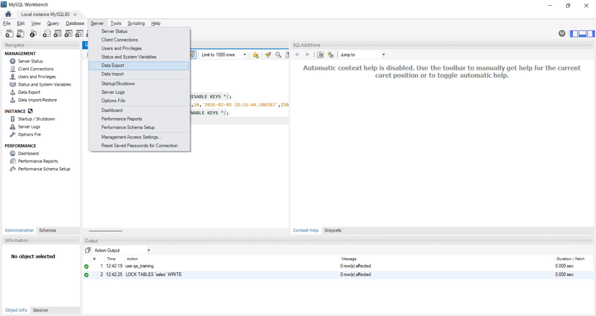
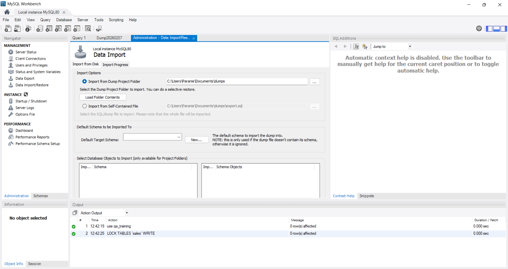
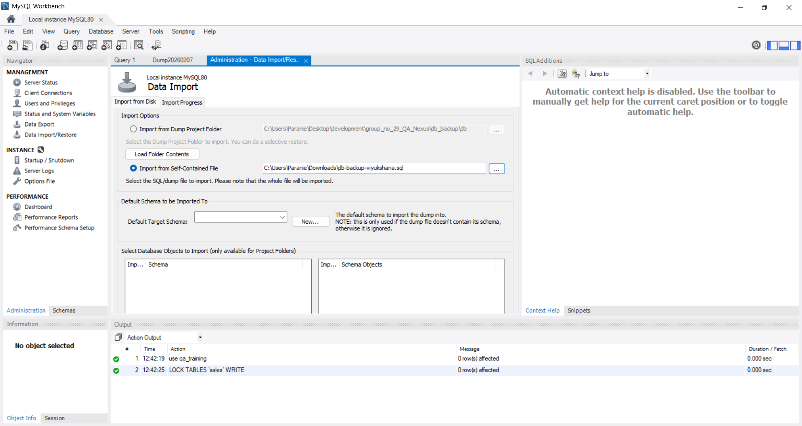
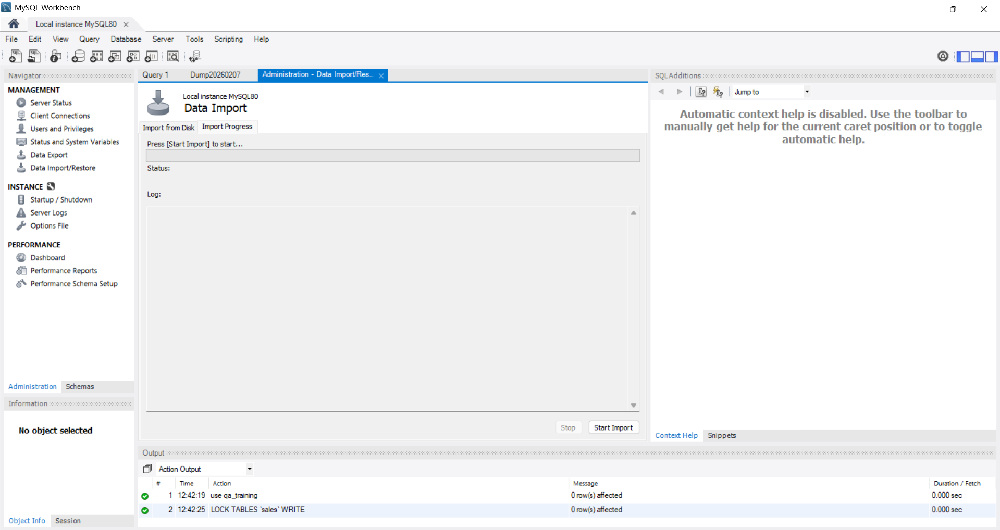

# Steps to Restore the Database Backup
1. Open MySQL Workbench and connect to your local MySQL server.

2. In the MySQL Workbench, go to the "Server" menu and select "Data Import".

3. In the "Data Import" tab, select the "Import from Self-Contained File" option.

4. Click on the "..." button next to the file path field and navigate to the location where you have saved the database backup file (e.g., `db_backup/master_db.sql`).

5. After selecting the backup file, choose the target schema where you want to restore the database